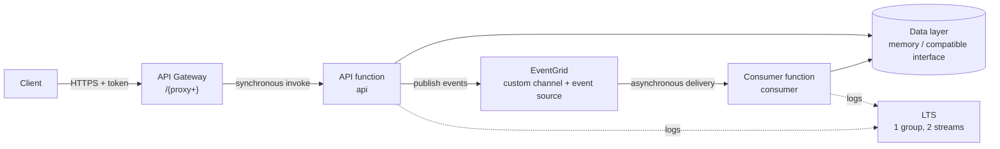

# Event-Driven E-commerce Backend

[](LICENSE)
[](https://www.huaweicloud.com)

Two serverless functions carry one complete e-commerce backend path: one acts as the REST entry for
orders and payments, the other subscribes to events and advances fulfilment state. Business state
moves through an event stream while the API only takes orders and opens the stream. It suits teams
designing event-driven architectures that want to see how the synchronous entry and the asynchronous
consumer divide responsibilities.

## Overview

The hard part of an event-driven backend is not "publishing events". It is three things: **where
events come from**, **how consumption stays idempotent**, and **where the consistency boundary
lies**. This sample pins down each:

- **Events come from explicit publication** — after an order is written, the API publishes the event
  explicitly instead of relying on a storage-level change stream. The event type is the business
  action (`OrderCreated`, `WarehouseCompleted`, `DeliveryCompleted`), so the producer/consumer
  contract lives in the event itself.
- **Consumption deduplicates twice** — it records both the event identifier and an operation key of
  "event type + order identifier". Either hit counts as a duplicate, returning `duplicate` without
  advancing state again.
- **Consistency uses conditional writes plus compensation** — orders, payments and idempotency
  records all put the user identifier in the primary key, and state transitions use a "current state
  matches" conditional write, so an illegal transition never overwrites existing state. That
  boundary provides no cross-table atomic commit, and the documentation states so explicitly.
- **Data access has two implementations** — the default memory mode verifies the business loop with
  no external dependency; switching to the compatible-interface mode changes one configuration value
  and no business code.

**What it solves**: it turns "order → payment → warehouse → delivery" into a deployable, verifiable
and replayable minimum loop.

**Who it is for**: businesses that need state progression with asynchronous decoupling — orders,
fulfilment, ticketing — and teams evaluating whether "synchronous entry plus asynchronous consumer"
fits them.

## Table of Contents

- [Architecture](#architecture)
- [Highlights](#highlights)
- [Cloud Services](#cloud-services)
- [Prerequisites](#prerequisites)
- [Quick Start](#quick-start)
- [Step-by-step Deployment](#step-by-step-deployment)
- [Usage and Verification](#usage-and-verification)
- [Repository Layout](#repository-layout)
- [Clean Up](#clean-up)
- [Further Reading](#further-reading)
- [FAQ](#faq)
- [License](#license)
- [Contact](#contact)

## Architecture



The synchronous entry only takes orders and opens the stream; all state advancement is done by the
asynchronous consumer, driven by event type.

| Layer | Service | Description |
|-|-|-|
| Ingress | API Gateway dedicated instance | Group + environment + one `/{proxy+}` + publication |
| API | FunctionGraph | 1 Python 3.10 function, 128 MB / 15 s, single-file inline |
| Consumer | FunctionGraph | 1 Python 3.10 function, 128 MB / 15 s, single-file inline |
| Events | EventGrid | Custom channel + application event source + one subscription (async, original payload) |
| Data | Memory / document database (compatible interface) | Four logical tables: products, orders, payment idempotency, event idempotency |
| Observability | LTS | One log group and two log streams |

## Highlights

- **Two execution roles, clear boundaries** — one function for the synchronous entry, one for the
  asynchronous consumer, so scaling and failure isolation land exactly where they belong.
- **Event semantics are business actions** — event types express state transitions directly, so the
  consumer never has to infer intent from field differences.
- **Double deduplication is verifiable** — redelivering the same event returns `duplicate`, and two
  events describing the same operation are handled once.
- **State transitions are guarded** — conditional writes ensure an illegal transition cannot
  overwrite existing state.
- **Zero external dependencies by default** — memory mode runs the whole loop without any cloud
  resource.
- **Strict token boundary** — only the signed `sub` and `roles` are trusted; request body fields
  never participate in authorization.

## Cloud Services

| Service | Role in this sample | Terraform resource |
|-|-|-|
| FunctionGraph | API function and consumer function | `huaweicloud_fgs_function` |
| API Gateway | Group, environment, one proxy API and publication (may reuse a shared instance) | `huaweicloud_apig_group`, `huaweicloud_apig_environment`, `huaweicloud_apig_api`, `huaweicloud_apig_api_publishment` |
| EventGrid | Custom channel, application event source, one subscription | `huaweicloud_eg_custom_event_channel`, `huaweicloud_eg_custom_event_source`, `huaweicloud_eg_event_subscription` |
| LTS | One log group and two log streams | `huaweicloud_lts_group`, `huaweicloud_lts_stream` |
| IAM | Agency used for event delivery | `huaweicloud_identity_agency` |
| Document database (compatible interface) | Four logical tables (used in compatible-interface mode) | Initialized by `src/scripts/bootstrap_geminidb.py` |

Release these resources when the sample is no longer needed, to avoid leaving them behind.

## Prerequisites

**Account and permissions**

- An account that has completed real-name verification, with `cn-north-4` available (this sample is
  validated against that region).
- Permission to enable and operate FunctionGraph, API Gateway, EventGrid and LTS.
- Access Key ID and Secret Access Key from the "My Credentials" page, supplied to the deployment
  shell. Never write credentials into code or commit them.

**External resources already in place**

- An API Gateway dedicated instance (a shared instance and environment can be reused).
- A document database instance and access key, needed only in compatible-interface mode. The default
  memory mode needs no external data plane.

**Tools and versions**

- Terraform CLI `>= 1.3`, huaweicloud provider `>= 1.95`, Python 3.9 or later.

**Region and naming constraints**

- `var.region` is fixed to `cn-north-4` (validated in `infra/variables.tf`).
- `var.eg_source_id` and `var.eg_target_id` build the subscription identifiers. Multiple deployments
  sharing the defaults interfere with each other, so multi-environment deployments must override
  them.

## Quick Start

```bash
# 1. Local unit tests (offline)
cd src && python -m pytest tests -q && cd ..

# 2. Generate a controlled token
python src/scripts/make_test_jwt.py --sub user-1 --roles customer

# 3. Static checks
cd infra && terraform init && terraform validate && cd ..

# 4. Supply deployment values and create resources
cd infra
export HW_ACCESS_KEY=<HW_ACCESS_KEY>
export HW_SECRET_KEY=<HW_SECRET_KEY>
export TF_VAR_shared_apig_instance_id="<API Gateway dedicated instance ID>"
export TF_VAR_shared_apig_env_id="<shared environment ID>"
export TF_VAR_jwt_secret="<token signing secret>"
terraform plan -out=retail.tfplan
terraform apply retail.tfplan

# 5. Verify
cd ..
python src/scripts/verify_e2e.py
```

## Step-by-step Deployment

### Step 1: Local unit tests

```bash
cd src
python -m pytest tests -q
cd ..
```

Expected output:

```text
4 passed in 0.02s
```

The tests cover the order state machine, event deduplication and business rules, all against the
in-memory implementation.

### Step 2: Generate a controlled token

```bash
python src/scripts/make_test_jwt.py --sub user-1 --roles customer
```

Expected: a token string, also written to `src/fixtures/test.jwt.json`. The token is signed with the
default `jwt_secret`; when using another secret, keep `TF_VAR_jwt_secret` consistent with it.

### Step 3: Static checks

```bash
cd infra
terraform init
terraform validate
```

Expected output:

```text
Success! The configuration is valid, but there were some
validation warnings as shown above.
```

### Step 4: Supply deployment values

The default memory mode needs no data plane configuration:

```bash
export TF_VAR_shared_apig_instance_id="<API Gateway dedicated instance ID>"
export TF_VAR_shared_apig_env_id="<shared environment ID>"
export TF_VAR_jwt_secret="<token signing secret>"
```

Add five data plane values when switching to compatible-interface mode:

```bash
export TF_VAR_repository_mode="dynamodb"
export TF_VAR_geminidb_endpoint="<data plane address>"
export TF_VAR_geminidb_access_key="<data plane access key ID>"
export TF_VAR_geminidb_secret_key="<data plane secret access key>"
```

Optional values (the full list is in `infra/variables.tf`):

| Variable | Default | Description |
|-|-|-|
| `app_name` / `namespace` | `retail-ecommerce-platform` | Resource name prefix and data namespace |
| `network_cidr` / `subnet_cidr` | `192.168.0.0/16` / `192.168.10.0/24` | Network ranges when deployed standalone |
| `shared_network_id` / `shared_subnet_id` | empty | Shared private network attachment, set as a pair |
| `repository_mode` | `memory` | `memory` or `dynamodb` |
| `geminidb_port` / `geminidb_protocol` / `geminidb_region` | `8000` / `https` / `cn-north-4` | Data plane connection and signing |
| `jwt_issuer` / `jwt_audience` | see `infra/variables.tf` | Token issuer and audience |
| `eg_source_id` / `eg_target_id` | fixed UUIDs | **Must be unique per deployment** |

### Step 5: Initialize the tables (compatible-interface mode only)

```bash
python src/scripts/bootstrap_geminidb.py
```

The script creates four tables per the `geminidb_*_table` values and writes sample products. It is
idempotent. Skip this step in memory mode.

### Step 6: Create resources

```bash
cd infra
terraform plan -out=retail.tfplan
terraform apply retail.tfplan
```

Expected output (reusing a shared gateway):

```text
Plan: 17 to add, 0 to change, 0 to destroy.
Apply complete! Resources: 17 added, 0 changed, 0 destroyed.
```

### Step 7: Read the outputs

```bash
terraform output
```

Common values:

```bash
terraform output api_invoke_url       # REST entry root address
terraform output repository_mode      # current data access mode
terraform output event_channel_id     # event channel ID
```

## Usage and Verification

### Minimal example: place an order and read it back

```bash
export BASE="$(terraform output -raw api_invoke_url)"
export TOKEN="<token produced by the generator script>"

curl -s -X POST "$BASE/orders" -H "Authorization: Bearer $TOKEN" \
  -H "Content-Type: application/json" \
  -d '{"items":[{"productId":"p-1","quantity":2}]}'
```

Expected 201 with an order in the `Created` state:

```json
{"orderId":"<order id>","userId":"user-1","status":"Created","total":198}
```

Read it back by identifier:

```bash
curl -s "$BASE/orders/<order id>" -H "Authorization: Bearer $TOKEN"
```

### Health check

```bash
curl -s "$BASE/health"
```

Expected 200; no token required.

### Run the end-to-end verification

```bash
python src/scripts/verify_e2e.py
```

The script runs end-to-end checks against the real gateway address and writes the result to
`verification-result.json`.

### Verify payment idempotency

```bash
curl -s -X POST "$BASE/payments" -H "Authorization: Bearer $TOKEN" \
  -H "Content-Type: application/json" \
  -d '{"orderId":"<order id>","amount":198}'
```

Submitting again for the same order does not authorize twice — the idempotency key is the order
identifier.

### Verify event-driven state advancement

```bash
terraform output consumer_log_stream_id
```

Search that log stream ID in the LTS console; you should see consumption records with the event
identifier and the result (`processed` / `duplicate` / `ignored`). Redelivering the same event
returns `duplicate`.

### Verify the user boundary

Read another user's order with a different `sub` token; expected 404:

```bash
export OTHER="<token for another sub>"
curl -s -o /dev/null -w "%{http_code}\n" "$BASE/orders/<other user's order id>" \
  -H "Authorization: Bearer $OTHER"
```

**After deployment, run the steps in this section in your own environment and confirm the features
work before treating the delivery as complete.**

## Repository Layout

```text
.
├── README.md
├── README.en.md
├── LICENSE
├── docs/
│   ├── architecture.md          Event model, state machine and trade-offs
│   └── deployment-guide.md      Step-by-step commands with expected output
├── infra/
│   ├── versions.tf              Terraform and provider version constraints
│   ├── variables.tf             Input variables
│   ├── main.tf                  Logs, agency, two functions, EventGrid, gateway
│   └── outputs.tf               Outputs
└── src/
    ├── api/index.py             API function: routing, auth, orders, payments, event publication
    ├── consumer/index.py        Consumer function: event parsing, dedup, state advancement
    ├── common/                  Shared package
    ├── fixtures/                Sample data and test tokens
    ├── scripts/
    │   ├── bootstrap_geminidb.py   Table initialization
    │   ├── make_test_jwt.py        Controlled token generation
    │   └── verify_e2e.py           Post-deployment verification
    └── tests/test_domain.py     Unit tests
```

## Clean Up

```bash
cd infra
terraform destroy
```

Expected output:

```text
Destroy complete! Resources: 17 destroyed.
```

Destroy removes both functions, the group/environment/API/publication, the event channel and
subscription, the log group and streams, and the agency. The data plane instance and the API Gateway
instance are shared resources and outside this directory's cleanup scope.

## Further Reading

- Event model, state machine and trade-offs: [docs/architecture.md](docs/architecture.md)
- Complete commands from zero to a verified deployment: [docs/deployment-guide.md](docs/deployment-guide.md)
- Chinese edition: [README.md](README.md)

## FAQ

**An endpoint returns 401.**
The token is missing, the signing secret differs, or the token expired.

**A valid path returns 404.**
Check whether the routing prefix matches the request path; a `/{proxy+}` API passes the complete path
to the function.

**Order state never advances.**
Check whether the order event was published, whether the subscription target is the consumer
function, and allow time for authorization propagation.

**A duplicate event was processed twice.**
Deduplication depends on the event `id` and the operation key of "event type + order identifier".
When the event lacks an `id`, only the second guard remains, so the publisher should always include
one.

**Compatible-interface mode returns 502.**
Check the data plane address, protocol, port, signing region and credentials one by one.

**Data disappears in memory mode.**
This is expected: the memory implementation does not retain data across invocations and exists only
to verify business logic.

**Logs are empty.**
Both functions must bind all four log parameters: group ID, group name, stream ID and stream name.

## License

This sample is released under the MIT No Attribution license. See [LICENSE](LICENSE).

## Contact

Created and maintained by: Public Cloud Continuous Operations Department.

Please open an issue in this repository if you run into problems; we review them regularly.
