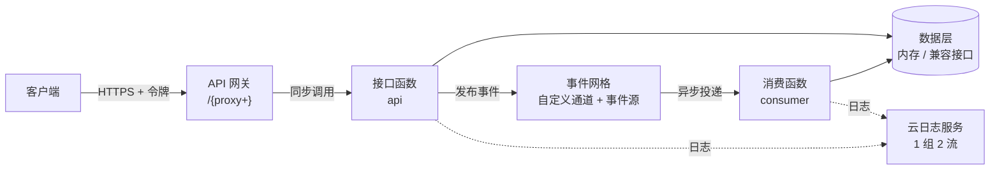

# 事件驱动电商后端实践

[](LICENSE)
[](https://www.huaweicloud.com)

用两个无服务器函数承载一条完整的电商后端链路：一个作为 REST 入口处理下单与支付，
另一个订阅事件推进履约状态。业务状态在事件流中推进，接口只负责接单与开流。
适用于正在设计事件驱动架构、想看清「同步入口 + 异步消费者」如何分工的团队。

## 简介

事件驱动后端的关键不在「发事件」，而在三件事：**事件从哪来**、**消费怎么幂等**、
**一致性边界在哪**。这套实践把三件事各自固定下来：

- **事件从显式发布来**：订单写入成功后由接口显式发布事件，不依赖存储层的变更流。
  事件类型就是业务动作（`OrderCreated`、`WarehouseCompleted`、`DeliveryCompleted`），
  生产与消费的契约写在事件本身。
- **消费双重去重**：同时记录事件标识与「事件类型 + 订单标识」的操作键，
  任一命中即视为重复，返回 `duplicate` 而不重复推进状态。
- **一致性用条件写与补偿**：订单、支付与幂等记录都把用户标识放进主键，
  状态推进使用「当前状态匹配」的条件写，非法跃迁不会覆盖已有状态。
  该边界不提供跨表原子提交，这一点在文档中显式保留。
- **数据访问双实现**：默认内存模式无需任何外部依赖即可验证业务闭环；
  切到兼容接口模式只需改一个配置项，业务代码不变。

**解决的问题**：把「下单 → 支付 → 仓储 → 配送」这条链路做成可部署、可验证、可重放的最小闭环。

**适用于**：订单、履约、工单等需要有状态推进与异步解耦的业务；
正在评估「同步入口 + 异步消费者」是否适合自己的团队。

## 目录

- [架构图](#架构图)
- [方案亮点](#方案亮点)
- [涉及云服务](#涉及云服务)
- [前置条件](#前置条件)
- [快速开始](#快速开始)
- [分步部署](#分步部署)
- [使用方法与验证](#使用方法与验证)
- [仓库结构](#仓库结构)
- [清理资源](#清理资源)
- [详细说明](#详细说明)
- [常见问题](#常见问题)
- [许可证](#许可证)
- [联系方式](#联系方式)

## 架构图



同步入口只接单与开流，状态推进全部由异步消费者按事件类型完成。

| 层次 | 承担的服务 | 说明 |
|-|-|-|
| 入口 | API 网关专享实例 | 分组 + 环境 + 单条 `/{proxy+}` + 发布 |
| 接口 | 函数计算 | 1 个 Python 3.10 函数，128 MB / 15 秒，单文件内联 |
| 消费 | 函数计算 | 1 个 Python 3.10 函数，128 MB / 15 秒，单文件内联 |
| 事件 | 事件网格 | 自定义通道 + 应用类事件源 + 单条订阅（异步、原文透传） |
| 数据 | 内存 / 文档数据库（兼容接口） | 四张逻辑表：商品、订单、支付幂等、事件幂等 |
| 观测 | 云日志服务 | 一个日志组与两条日志流 |

## 方案亮点

- **两个执行角色，边界清晰**：同步入口与异步消费者各一个函数，
  伸缩与失败隔离正好落在这两个位置上。
- **事件语义即业务动作**：事件类型直接表达状态推进，消费端不需要从字段差异反推意图。
- **双重去重可验证**：重复投递同一事件返回 `duplicate`，同一业务动作发两个事件也只处理一次。
- **状态推进有守卫**：条件写保证非法跃迁不会覆盖已有状态。
- **默认零外部依赖**：内存模式下无需任何云端资源即可跑通全链路。
- **令牌边界严格**：只信任签名后的 `sub` 与 `roles`，请求体字段不参与授权。

## 涉及云服务

| 云服务 | 本实践中的职责 | 对应 Terraform 资源 |
|-|-|-|
| 函数计算 | 接口函数与消费函数 | `huaweicloud_fgs_function` |
| API 网关 | 分组、环境、单条代理 API 与发布（可复用共享实例） | `huaweicloud_apig_group`、`huaweicloud_apig_environment`、`huaweicloud_apig_api`、`huaweicloud_apig_api_publishment` |
| 事件网格 | 自定义通道、应用类事件源、单条订阅 | `huaweicloud_eg_custom_event_channel`、`huaweicloud_eg_custom_event_source`、`huaweicloud_eg_event_subscription` |
| 云日志服务 | 一个日志组与两条日志流 | `huaweicloud_lts_group`、`huaweicloud_lts_stream` |
| 统一身份认证服务 | 事件投递所需委托 | `huaweicloud_identity_agency` |
| 文档数据库（兼容接口） | 四张逻辑表（兼容接口模式下使用） | 由 `src/scripts/bootstrap_geminidb.py` 初始化 |

确认不再需要本实践后，及时释放上述资源，避免残留。

## 前置条件

**账号与权限**

- 已开通账号并完成实名认证，可用区域为 `cn-north-4`（本实践在该区域验证，带参数校验）。
- 具备函数计算、API 网关、事件网格与云日志服务的开通与操作权限。
- 在「我的凭证」页面获取 Access Key ID 与 Secret Access Key，填入部署脚本；
  不要把凭据写入代码或提交到仓库。

**已就绪的外部资源**

- 一个 API 网关专享实例（可复用共享实例与环境）。
- 仅当使用兼容接口模式时，才需要一个文档数据库实例及其访问密钥。
  默认内存模式无需任何外部数据面。

**工具与版本**

- Terraform CLI `>= 1.3`，huaweicloud Provider `>= 1.95`，Python 3.9 及以上。

**区域与命名约束**

- `var.region` 固定为 `cn-north-4`（`infra/variables.tf` 带校验）。
- `var.eg_source_id` 与 `var.eg_target_id` 用于构造订阅标识，多个部署共用默认值会互相干扰，
  多环境部署时必须各自覆盖。

## 快速开始

```bash
# 1. 本地单元测试（离线）
cd src && python -m pytest tests -q && cd ..

# 2. 生成受控令牌
python src/scripts/make_test_jwt.py --sub user-1 --roles customer

# 3. 静态校验
cd infra && terraform init && terraform validate && cd ..

# 4. 填写部署参数并创建资源
cd infra
export HW_ACCESS_KEY=<HW_ACCESS_KEY>
export HW_SECRET_KEY=<HW_SECRET_KEY>
export TF_VAR_shared_apig_instance_id="<APIG 专享实例 ID>"
export TF_VAR_shared_apig_env_id="<共享环境 ID>"
export TF_VAR_jwt_secret="<令牌签名密钥>"
terraform plan -out=retail.tfplan
terraform apply retail.tfplan

# 5. 验证
cd ..
python src/scripts/verify_e2e.py
```

## 分步部署

### 第 1 步：本地单元测试

```bash
cd src
python -m pytest tests -q
cd ..
```

预期输出：

```text
4 passed in 0.02s
```

测试覆盖订单状态机、事件去重与业务规则，全部使用内存实现。

### 第 2 步：生成受控令牌

```bash
python src/scripts/make_test_jwt.py --sub user-1 --roles customer
```

预期输出一个令牌字符串，并同时写入 `src/fixtures/test.jwt.json`。
令牌用 `jwt_secret` 的默认值签名；改用其它密钥时保持 `TF_VAR_jwt_secret` 与之一致。

### 第 3 步：静态校验

```bash
cd infra
terraform init
terraform validate
```

预期输出：

```text
Success! The configuration is valid, but there were some
validation warnings as shown above.
```

### 第 4 步：填写部署参数

默认内存模式无需数据面配置：

```bash
export TF_VAR_shared_apig_instance_id="<APIG 专享实例 ID>"
export TF_VAR_shared_apig_env_id="<共享环境 ID>"
export TF_VAR_jwt_secret="<令牌签名密钥>"
```

切到兼容接口模式时补充数据面五项：

```bash
export TF_VAR_repository_mode="dynamodb"
export TF_VAR_geminidb_endpoint="<数据面地址>"
export TF_VAR_geminidb_access_key="<数据面访问密钥 ID>"
export TF_VAR_geminidb_secret_key="<数据面访问密钥 Secret>"
```

可选参数（完整清单见 `infra/variables.tf`）：

| 变量 | 默认值 | 说明 |
|-|-|-|
| `app_name` / `namespace` | `retail-ecommerce-platform` | 资源名前缀与数据命名空间 |
| `network_cidr` / `subnet_cidr` | `192.168.0.0/16` / `192.168.10.0/24` | 自建实例时的网络网段 |
| `shared_network_id` / `shared_subnet_id` | 空 | 挂接共享私网，成对提供 |
| `repository_mode` | `memory` | `memory` 或 `dynamodb` |
| `geminidb_port` / `geminidb_protocol` / `geminidb_region` | `8000` / `https` / `cn-north-4` | 数据面连接与签名 |
| `jwt_issuer` / `jwt_audience` | 见 `infra/variables.tf` | 令牌签发者与受众 |
| `eg_source_id` / `eg_target_id` | 固定 UUID | **每个部署需唯一** |

### 第 5 步：初始化数据表（仅兼容接口模式）

```bash
python src/scripts/bootstrap_geminidb.py
```

脚本按 `geminidb_*_table` 的取值创建四张表并写入样例商品，幂等可重复执行。
内存模式下跳过本步。

### 第 6 步：创建资源

```bash
cd infra
terraform plan -out=retail.tfplan
terraform apply retail.tfplan
```

预期输出（复用共享网关时）：

```text
Plan: 17 to add, 0 to change, 0 to destroy.
Apply complete! Resources: 17 added, 0 changed, 0 destroyed.
```

### 第 7 步：查看部署输出

```bash
terraform output
```

常用取值：

```bash
terraform output api_invoke_url       # REST 入口根地址
terraform output repository_mode      # 当前数据访问模式
terraform output event_channel_id     # 事件通道 ID
```

## 使用方法与验证

### 最简示例：下一次单并查询

```bash
export BASE="$(terraform output -raw api_invoke_url)"
export TOKEN="<由生成脚本产出的令牌>"

curl -s -X POST "$BASE/orders" -H "Authorization: Bearer $TOKEN" \
  -H "Content-Type: application/json" \
  -d '{"items":[{"productId":"p-1","quantity":2}]}'
```

预期返回 201 与订单，状态为 `Created`：

```json
{"orderId":"<订单标识>","userId":"user-1","status":"Created","total":198}
```

按标识查询：

```bash
curl -s "$BASE/orders/<订单标识>" -H "Authorization: Bearer $TOKEN"
```

### 健康检查

```bash
curl -s "$BASE/health"
```

预期返回 200，不需要令牌。

### 一次跑完端到端校验

```bash
python src/scripts/verify_e2e.py
```

脚本对真实网关地址做端到端校验，并把结果写入 `verification-result.json`。

### 验证支付幂等

```bash
curl -s -X POST "$BASE/payments" -H "Authorization: Bearer $TOKEN" \
  -H "Content-Type: application/json" \
  -d '{"orderId":"<订单标识>","amount":198}'
```

用同一订单再次提交不会重复授权——幂等键是订单标识。

### 验证事件驱动的状态推进

```bash
terraform output consumer_log_stream_id
```

在云日志服务控制台按该日志流检索，预期看到消费记录，包含事件标识与处理结果
（`processed` / `duplicate` / `ignored`）。重复投递同一事件返回 `duplicate`。

### 验证用户边界

用另一个 `sub` 的令牌读取他人订单，预期返回 404：

```bash
export OTHER="<另一个 sub 的令牌>"
curl -s -o /dev/null -w "%{http_code}\n" "$BASE/orders/<他人的订单标识>" \
  -H "Authorization: Bearer $OTHER"
```

**部署完成后请按本节步骤在真实环境自行验证，确认功能可用后方可视为交付完成。**

## 仓库结构

```text
.
├── README.md
├── README.en.md
├── LICENSE
├── docs/
│   ├── architecture.md          事件模型、状态机与关键设计取舍
│   └── deployment-guide.md      分步部署命令与每步预期输出
├── infra/
│   ├── versions.tf              Terraform 与 Provider 版本约束
│   ├── variables.tf             输入变量
│   ├── main.tf                  日志、委托、两个函数、事件网格、网关
│   └── outputs.tf               对外输出
└── src/
    ├── api/index.py             接口函数：路由、鉴权、下单、支付、事件发布
    ├── consumer/index.py        消费函数：事件解析、去重、状态推进
    ├── common/                  公共包
    ├── fixtures/                样例数据与测试令牌
    ├── scripts/
    │   ├── bootstrap_geminidb.py   数据表初始化
    │   ├── make_test_jwt.py       受控令牌生成
    │   └── verify_e2e.py          部署后校验
    └── tests/test_domain.py     单元测试
```

## 清理资源

```bash
cd infra
terraform destroy
```

预期输出：

```text
Destroy complete! Resources: 17 destroyed.
```

销毁会删除两个函数、分组/环境/API/发布、事件通道与订阅、日志组与日志流、委托。
数据面实例与网关专享实例属共享资源，不在本目录的清理范围。

## 详细说明

- 事件模型、状态机与关键设计取舍：[docs/architecture.md](docs/architecture.md)
- 从零到可验证部署的完整命令与预期输出：[docs/deployment-guide.md](docs/deployment-guide.md)
- 英文版说明：[README.en.md](README.en.md)

## 常见问题

**接口返回 401。**
令牌缺失、签名密钥不一致或已过期。

**接口返回 404 且路径存在。**
检查路由分发的前缀是否与请求路径一致；`/{proxy+}` 会把完整路径传给函数。

**下单后状态没有推进。**
订单事件是否发布成功；订阅目标是否为消费函数；授权传播需要时间，稍候重试。

**重复事件被处理了两次。**
去重依赖事件 `id` 与「事件类型 + 订单标识」操作键。事件缺 `id` 时只剩第二层保护，
应确保发布侧始终带 `id`。

**兼容接口模式返回 502。**
逐项核对数据面地址、协议、端口、签名区域与凭据。

**内存模式数据消失了。**
属预期：内存实现不跨调用保留数据，仅用于验证业务逻辑。

**日志为空。**
两个函数必须同时绑定日志组 ID / 名称与日志流 ID / 名称四个参数。

## 许可证

本实践采用 MIT No Attribution 许可证发布，详见 [LICENSE](LICENSE)。

## 联系方式

创建与维护团队：公有云持续运营部。

使用中遇到问题请在本仓库提交议题，我们会定期查看。
