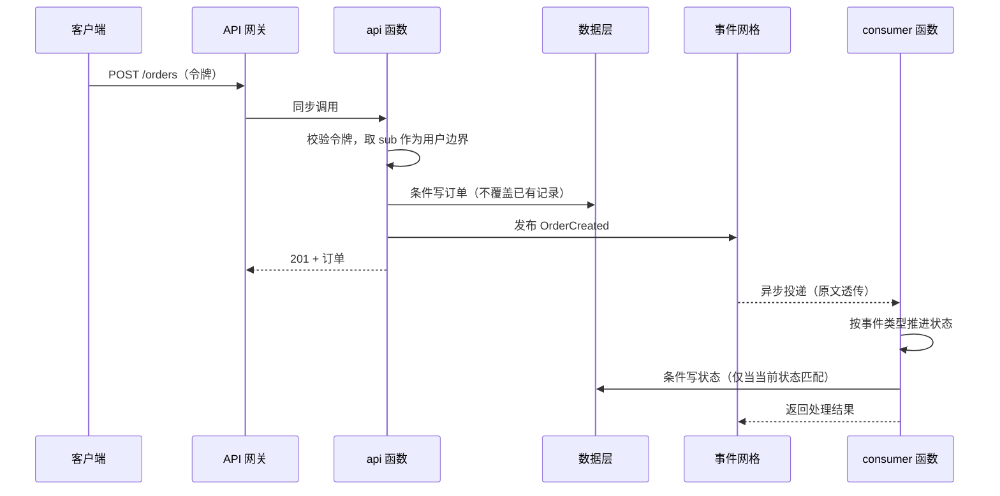
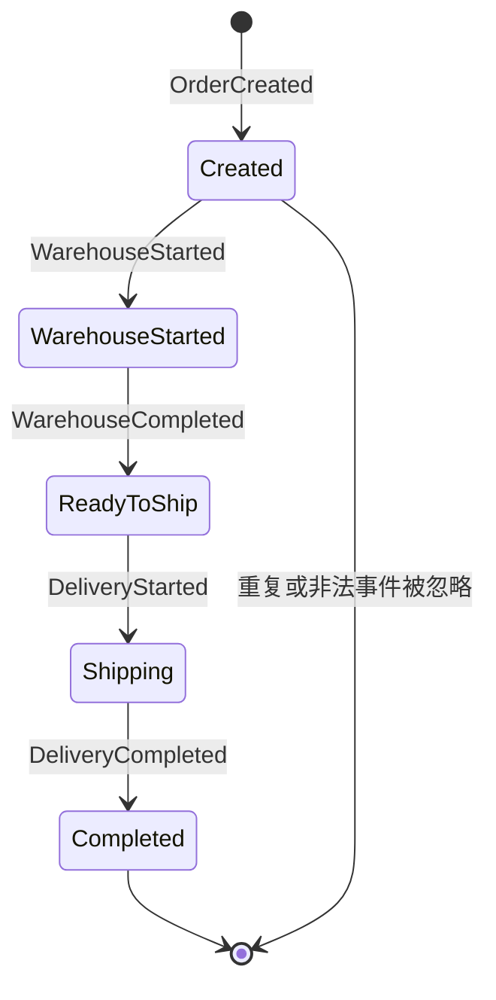
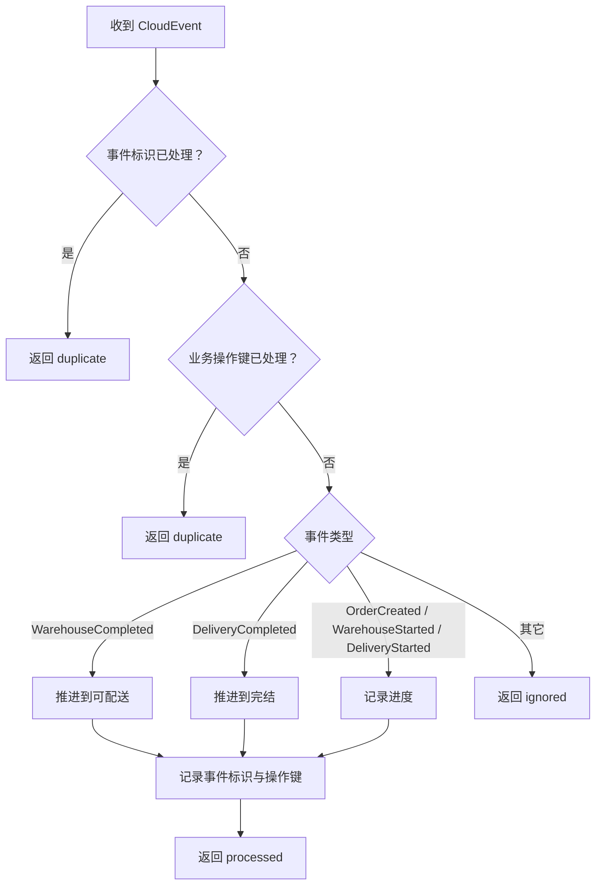

# 架构与技术设计

本文说明本实践的事件驱动电商后端架构、端到端数据流与关键设计取舍。
部署命令见 [deployment-guide.md](deployment-guide.md)，功能概览见仓库根目录 `README.md`。

## 1. 分层与职责

| 层 | 职责 | 落地位置 |
|-|-|-|
| 入口层 | 统一 REST 入口，单条 `/{proxy+}` 路由 | `infra/main.tf` 的分组、环境、API 与发布 |
| 接口层 | 路由分发、令牌校验、订单与支付处理 | `src/api/index.py` |
| 履约层 | 消费履约事件、推进订单状态机 | `src/consumer/index.py` |
| 事件层 | 自定义通道、事件源与订阅 | `infra/main.tf` 的事件网格资源 |
| 数据层 | 双实现（内存 / 兼容接口） | `src/api/index.py`、`src/consumer/index.py` |
| 观测层 | 两条运行日志流 | `infra/main.tf` 的日志组与日志流 |

## 2. 组件清单

### 2.1 两个函数（`infra/main.tf`）

| 组件 | 运行时 / 规格 | 职责 |
|-|-|-|
| `api` | Python 3.10 / 128 MB / 15 秒 | REST ingress：用户、商品、订单、支付 |
| `consumer` | Python 3.10 / 128 MB / 15 秒 | 履约事件消费：仓储、配送状态推进 |

两个函数均为单文件内联部署，日志四参数全部绑定。

### 2.2 入口与事件

| 组件 | 配置要点 |
|-|-|
| 分组 / 环境 | 分组开启调试子域名；环境名由变量给出 |
| API | 单条 `/{proxy+}`，方法 ANY，后端为 api 函数的同步调用 |
| 事件通道 | 1 个自定义通道 |
| 事件源 | 1 个应用类事件源，名称为 `<应用前缀>-order-lifecycle` |
| 订阅 | 1 条，目标为 consumer 函数的异步投递，转换为原文透传 |

### 2.3 业务路径

接口函数按路径分发，主要路径如下：

| 方法 | 路径 | 说明 |
|-|-|-|
| GET | `/health` | 健康检查，不校验令牌 |
| POST | `/orders` | 创建订单并发布订单事件 |
| GET | `/orders/{order_id}` | 查询订单 |
| GET | `/products` | 商品列表 |
| GET | `/products/{product_id}` | 单件商品 |
| POST | `/payments` | 幂等支付授权（模拟） |

### 2.4 事件类型

消费函数按事件 `type` 推进状态机：

| 事件类型 | 处理 |
|-|-|
| `OrderCreated` | 记录订单已创建，等待仓储 |
| `WarehouseStarted` | 标记仓储开始 |
| `WarehouseCompleted` | 订单进入可配送状态 |
| `DeliveryStarted` | 标记配送开始 |
| `DeliveryCompleted` | 订单完结 |

其余类型返回 `ignored`；重复事件按事件标识与业务操作键双重去重，返回 `duplicate`。

## 3. 端到端数据流

### 3.1 一次下单到履约的完整时序

### 3.2 订单状态机

状态推进使用「当前状态匹配」的条件写，非法跃迁不会覆盖已有状态。

### 3.3 消费函数的事件判定

### 3.4 云侧调用面

| 调用面 | 用途 | 备注 |
|-|-|-|
| 事件网格 | 发布订单与履约事件 | `source` 与事件源同名；`type` 表达业务动作 |
| 文档数据（兼容接口） | 订单、用户、商品、幂等记录读写 | 标准 JSON 协议 + 请求签名 |
| 内存实现 | 本地与默认模式 | 无需外部依赖 |

## 4. 运行期配置契约

| 键 | 用途 |
|-|-|
| `REPOSITORY_MODE` | `memory` 或 `dynamodb`，决定数据访问实现 |
| `DATA_NAMESPACE` | 表名前缀与键前缀 |
| `GEMINI_ENDPOINT` / `PORT` / `PROTOCOL` / `REGION` | 数据面地址与签名区域 |
| `GEMINI_ACCESS_KEY` / `GEMINI_SECRET_KEY` | 数据面凭据（敏感） |
| `JWT_SECRET` | 令牌签名密钥（敏感） |
| `EVENT_CHANNEL_ID` / `EVENT_SOURCE_NAME` | 事件发布目标 |
| `REGION` / `PROJECT_ID` | 区域与项目标识 |

默认 `memory` 模式不要求任何外部配置，便于本地与首次验证。

## 5. 关键设计取舍

### 5.1 为什么部署单元从 13 个收敛为 2 个

把订单、支付、履约、商品、用户拆成独立部署单元，收益是团队自治，
代价是 13 份部署描述与一条跨服务的契约链。样例要展示的是「事件驱动 + 状态推进」这一核心模式，
因此按「同步入口」与「异步消费」两个执行角色划分部署单元——
这正是事件驱动架构中真正需要独立伸缩与独立失败边界的两个位置。

### 5.2 为什么一致性用条件写与补偿而不是事务

跨表事务要求所有参与表在同一事务域内，而微服务化的前提恰恰是各域数据自治。
改用「存在性条件写 + 状态条件推进 + 应用层补偿」后，每一步都是幂等且可重放的：
重复订单不会覆盖已有记录，非法状态跃迁不会生效，重复事件被去重。
代价是不提供跨表原子提交——这一点在运维与对账流程中必须显式保留。

### 5.3 为什么用显式事件而不是变更流

变更流把「数据变化」当成「业务事件」，读起来省事，但把触发时机绑死在存储层：
换存储实现就要重做触发链，且事件语义只能靠字段推断。显式发布事件后，
事件类型就是业务动作（`OrderCreated`、`WarehouseCompleted`），
生产方与消费方的契约写在事件本身，与存储实现解耦。

### 5.4 为什么消费函数要做双重去重

事件投递是至少一次语义，重复投递必然发生。只按事件标识去重会漏掉「同一业务动作被发布两次」的情形
（例如重试导致两个不同标识但语义相同的事件）。因此同时记录事件标识与「事件类型 + 订单标识」的操作键，
两者任一命中即视为重复。

### 5.5 为什么保留内存实现

本地单元测试与首次验证不应依赖云端资源。内存实现让 `python -m pytest` 在无网络环境下
覆盖状态机、去重与业务规则；切到兼容接口实现只需改一个配置项，业务代码不变。

### 5.6 为什么支付用幂等模拟

真实支付网关涉及外部系统、回调与对账，不属于「事件驱动订单流程」这一核心能力。
模拟实现保留了三件关键性质：幂等（同一操作键只授权一次）、不可逆（返回的令牌不可再次消费）、
状态可查（金额与结果随订单保存）。这足以验证业务流程，又不引入外部依赖。

## 6. 扩展点

- **加业务路由**：在 `src/api/index.py` 的 `route()` 里增加路径分支。
- **加事件类型**：在消费函数的状态映射里注册新类型，并在发布侧补上对应事件。
- **切真实数据面**：把 `REPOSITORY_MODE` 从 `memory` 改为 `dynamodb` 并填齐数据面参数。
- **加补偿动作**：消费函数的失败分支是唯一收口，补偿逻辑集中在此。
- **拆回微服务**：路由与事件边界已经显式，按业务域切分部署单元时不需要重写契约。
